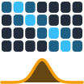

# sigpyproc

```{raw} html
<div class="spp-hero-card">
  
  
  <p class="spp-hero-lede">
    A modern, object-oriented Python library for FRB and pulsar data analysis.
  </p>
</div>
```

[](https://github.com/FRBs/sigpyproc3/actions)
[](https://sigpyproc3.readthedocs.io/en/latest/?badge=latest)
[](https://codecov.io/gh/FRBs/sigpyproc3)
[](https://github.com/FRBs/sigpyproc3/blob/main/LICENSE)
[](https://github.com/astral-sh/ruff)
[](https://scientific-python.org/specs/spec-0000/)

---

**sigpyproc** reads filterbanks, time series, and related products, then processes them from Python or small `spp_*` commands. Numerical kernels are compiled with [Numba](https://numba.pydata.org/) on first use. Originally developed as a Python alternative to the
[SIGPROC filterbank](http://sigproc.sourceforge.net) toolbox, the project has evolved into an independent framework for structured pulsar/FRB data manipulation.

It is aimed at inspecting data, checking a format, and prototyping an analysis ahead of a survey pipeline. Periodic search is an FFT with harmonic summing. Single-pulse search uses a boxcar. Format and method boundaries are listed on {doc}`capabilities`.

## Features

- **Objects** — Filterbank, [PSRFITS](https://www.atnf.csiro.au/research/pulsar/psrfits_definition/Psrfits.html), `TimeSeries`, `FourierSeries`, and `CandidateTable`.
- **Search as an API** — FFT harmonic folds and single-pulse search, both returned as one CSV-friendly table. See {doc}`tutorials/search`.
- **Streaming reads** — Block I/O, so a full observation does not have to sit in memory.
- **Structured Metadata** — Explicit header schemas for metadata handling.
- **Viewers** — Waterfall, time series, and spectrum plots, including a batch mode that writes image files.

## Get started

::::{grid} 1 2 3 3
:gutter: 2

:::{grid-item-card} 🚀 Installation
:link: install
:link-type: doc
:padding: 2

Python 3.12 or newer, with pip or uv.
:::

:::{grid-item-card} 📘 Getting started
:link: tutorials/basics
:link-type: doc
:padding: 2

Open a file, read the header, chain methods.
:::

:::{grid-item-card} 📊 Quickstart
:link: tutorials/quickstart
:link-type: doc
:padding: 2

Plots and a short search on synthetic data.
:::

:::{grid-item-card} 🔎 Search
:link: tutorials/search
:link-type: doc
:padding: 2

FFT, single pulses, and a candidate table.
:::

:::{grid-item-card} 📡 Simulate
:link: tutorials/fake
:link-type: doc
:padding: 2

A mock FRB, or a pulse injected into a file.
:::

:::{grid-item-card} 🖥️ Command line
:link: cmd
:link-type: doc
:padding: 2

Headers, viewers, folding, and `spp_search`.
:::
::::

```{toctree}
:caption: User Guide
:hidden:
:maxdepth: 1

install
capabilities
cmd
generated/sigpyproc
dev
changes
```

```{toctree}
:caption: Tutorials
:hidden:
:maxdepth: 1

Objects and headers <tutorials/basics>
Plots and a quick search <tutorials/quickstart>
PSRFITS conversion <tutorials/io>
Fold, save, and plot <tutorials/folding>
Viewers and exports <tutorials/viewers>
Searching time series <tutorials/search>
Simulating pulses <tutorials/fake>
Editing SIGPROC headers <tutorials/header>
```
